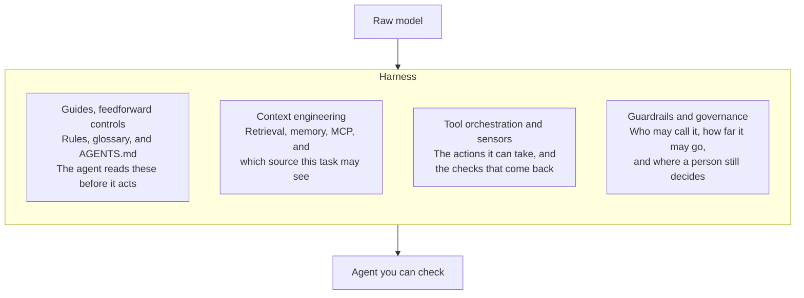
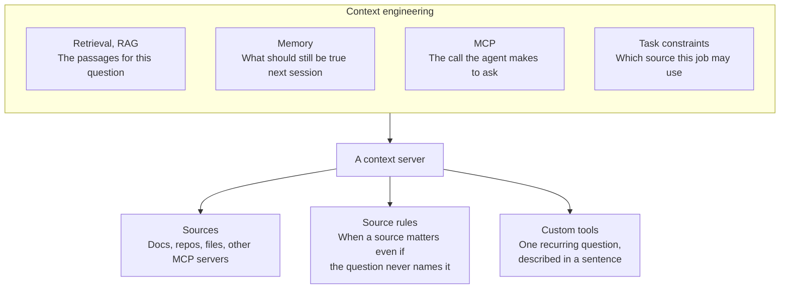

# Harness Engineering Cookbook

Recipes for the environment around an AI agent. Pick the folder for your job and follow those steps. The `recipes/` folder explains the four parts of a harness once, for every persona.

A harness is the surrounding infrastructure that turns a raw model into an agent you can rely on. The model still writes. The harness decides what it reads first, what it is allowed to see, which tools it may call, and where a person still has to approve the result.

A context server is the context piece of that harness. It is RAG exported as an MCP server: it retrieves the passages that answer a question from the sources you give it, and it serves them from an MCP endpoint an agent calls. [Choose a context server](recipes/choose-a-context-server.md) lists the capabilities the recipes need, and open source and hosted options to check.

The concepts follow [Learn Harness Engineering](https://github.com/walkinglabs/learn-harness-engineering). That course is the theory. This repo is the steps.

## How this repo is organized

| | What it is | When to open it |
| --- | --- | --- |
| A persona folder | The steps for one job | Start here |
| [`recipes/`](recipes/README.md) | The shared map: guides, context, tools, guardrails | When you want the part named, not the steps for your job |
| [`examples/`](examples/README.md) | Whole harness architectures you can clone, starting with a docs site | When you want to see every part working together in one application |

Writers, docs engineers, context engineers, and developer advocates publish the context pipeline. Developers and vibe coders call the MCP servers that pipeline produces.

## Start in your folder

| You | Folder | The recipes cover |
| --- | --- | --- |
| Vibe coder | [vibe-coders](vibe-coders/README.md) | A three-line guide, the stack's docs as an MCP server, and a citation check before you continue |
| Technical writer | [technical-writers](technical-writers/README.md) | Pages a harness can cite, exported as an MCP server, then handed to a developer |
| Docs engineer | [docs-engineers](docs-engineers/README.md) | Which source answers which question, the pipeline, and a citation check after each publish |
| Context engineer | [context-engineers](context-engineers/README.md) | Memory versus retrieval, rules and custom tools, and keeping one endpoint current |
| Developer advocate | [developer-advocates](developer-advocates/README.md) | The quickstart on a server, a tool for the current sample, and publishing only the steps you followed |
| Developer | [developers](developers/README.md) | Connecting the MCP servers those people already shipped, and adding one only for a repo they do not cover |

Each persona recipe says what you will have, the steps, and how you know it worked.

## What is in `recipes/`

Four explanations, a pointer, and a page for choosing a context server. Details are in [recipes/README.md](recipes/README.md).

| File | Part of the harness |
| --- | --- |
| [Guides](recipes/01-guides.md) | What the agent reads before it acts |
| [Context engineering](recipes/02-context-engineering.md) | What it is allowed to retrieve, and the MCP server it asks |
| [Tool orchestration](recipes/03-tool-orchestration.md) | Which actions it may take, and the check that decides the work is done |
| [Guardrails](recipes/04-guardrails.md) | Who may call the server, and what a person still approves |
| [Where to go](recipes/05-walk-the-pipeline.md) | A pointer to the persona folders. Not a fifth part |
| [Choose a context server](recipes/choose-a-context-server.md) | The capabilities the recipes need, and options to check |

## The four parts

Guides, tools, and guardrails keep the agent inside the work. Context engineering is what the work is made of: the pages, the repo, the spec, and the notes that should still be true next session.

## Context engineering, up close

Retrieval, the work people call RAG, is the passages for this question. Memory is what should still be true when the next session starts. MCP is the call the agent makes to ask, instead of waiting for someone to paste a page into the chat. Task constraints say which source this job is allowed to use.

| Piece | What you put there | Shared recipe |
| --- | --- | --- |
| Retrieval | The docs site, the repo, the spec, the PDF | [Context engineering](recipes/02-context-engineering.md) |
| Memory | The short guide that loads every session, and the server the agent asks when it needs a page | [Guides](recipes/01-guides.md) and [Context engineering](recipes/02-context-engineering.md) |
| MCP | One endpoint an MCP client can call | [Context engineering](recipes/02-context-engineering.md) |
| Task constraints | A source rule, and a private server when the source stays inside the company | [Context engineering](recipes/02-context-engineering.md) and [Guardrails](recipes/04-guardrails.md) |

## How the course maps onto `recipes/`

| This folder | [Learn Harness Engineering](https://github.com/walkinglabs/learn-harness-engineering) |
| --- | --- |
| [Guides](recipes/01-guides.md) | Instructions, and scope: one page or one feature at a time |
| [Context engineering](recipes/02-context-engineering.md) | State the next session can read, and the knowledge fetched on demand |
| [Tool orchestration](recipes/03-tool-orchestration.md) | Verification: a check that has to pass before the work counts as done |
| [Guardrails](recipes/04-guardrails.md) | Where a session may start, what it may touch, and the handoff it must leave |

## Link to a stable version

To link to a page or a heading here, put a release tag such as `v1.0.0` in the URL instead of `main`. Tagged text never changes, moved files keep a stub, and renamed headings keep their old anchor, as the [versioning policy](VERSIONING.md) describes. To cite the repository itself, use [CITATION.cff](CITATION.cff).

## Related

- [Ship with AI](https://github.com/zthewriter/ship-with-ai): plain-language guides for shipping an app with an agent, including what RAG is.
- [Context for AI](https://github.com/zthewriter/context-for-ai): how to write the pages a retrieval system can use.
- [Awesome Context Observability](https://github.com/zthewriter/awesome-context-observability): tools that show which passages an answer used. Rendered list: [zthewriter.github.io/awesome-context-observability](https://zthewriter.github.io/awesome-context-observability/).

## License

Recipes, writing, and diagrams are released under
[CC BY 4.0](LICENSE-CONTENT): use them anywhere, including commercially, with
credit. Code, scripts, workflows, and skills are released under the
[MIT License](LICENSE). To contribute, read [CONTRIBUTING.md](CONTRIBUTING.md).
