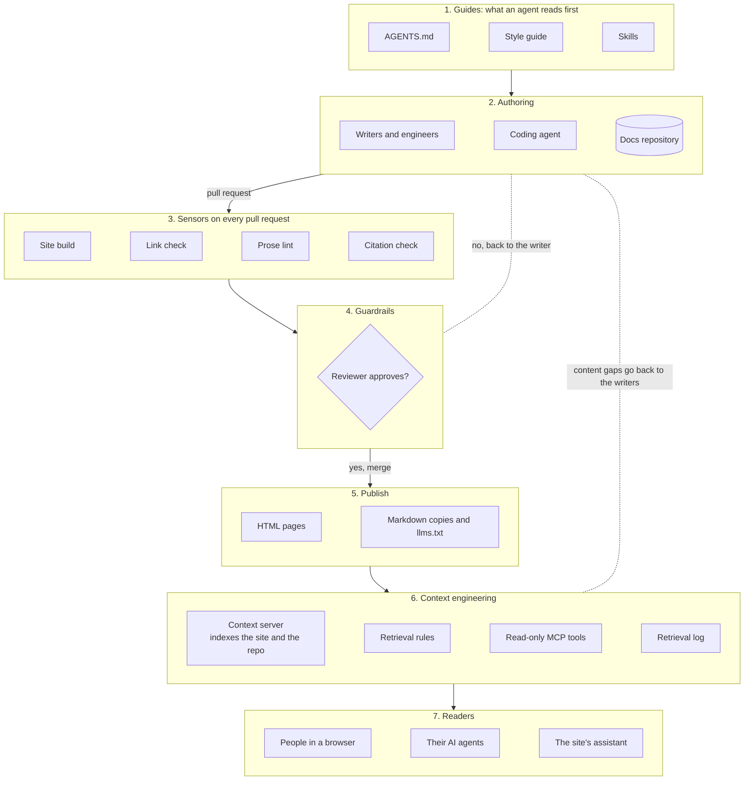

# Docs site harness

This example is the whole harness for one web application: a documentation site.
It covers how pages are written, checked, and published, and how people and AI
agents get answers from them. Clone it, replace the bracketed values, and you have
a starting harness for your own docs site.

## Who

Technical writers, docs engineers, and context engineers who run a docs site that
people read in a browser and AI agents query over MCP.

## You will have

A docs repository whose agent instructions, checks, and approvals are written down,
and a context server that answers from the published pages with a link to each one.

## The architecture

The diagram shows the four parts of the harness around a docs site, and the loop
that sends unanswered questions back to the writers.



The diagram shows these steps:

1. Writers and engineers change pages in the docs repository, or ask a coding agent
   to. The agent reads `AGENTS.md`, the style guide, and the skills before it acts.
2. Every pull request runs four checks: the site build, a link check, a prose lint,
   and a citation check.
3. A reviewer approves the change before it merges. A change that fails a check or
   the review goes back to the writer.
4. Publishing builds HTML pages, a Markdown copy of each page, and `llms.txt`.
5. A context server indexes the published site and the repository, applies the
   retrieval rules, and serves read-only tools over MCP.
6. People read the site in a browser. Their AI agents, and the site's own
   assistant, call the context server and get passages with links.
7. Questions with no good match land in the retrieval log, and go back to the
   writers as pages to write or fix.

## The parts and their files

The following table maps each part of the diagram to the file that defines it in
this folder, and the recipe that explains it:

| Part | File in this folder | Recipe |
|---|---|---|
| Guides | [AGENTS.md](AGENTS.md), [write a docs page skill](.agents/skills/write-a-docs-page/SKILL.md) | [Guides](../../recipes/01-guides.md) |
| Context engineering | [Context source map](harness/context-source-map.md), [retrieval rules](harness/retrieval-rules.md) | [Context engineering](../../recipes/02-context-engineering.md) |
| Tools and sensors | [Tool catalog](harness/tool-catalog.md), [definition of done](harness/definition-of-done.md) | [Tool orchestration](../../recipes/03-tool-orchestration.md) |
| Guardrails | [Guardrails and approvals](harness/guardrails.md) | [Guardrails](../../recipes/04-guardrails.md) |
| Published site | Your site generator's config | [Publish Markdown and llms.txt](../../recipes/06-publish-markdown-and-llms-txt.md) |
| Retrieval log | Your context server's log | [Observe delivered context](../../recipes/12-observe-delivered-context.md) |

## Clone this example

To copy this folder into a new directory, run the following command:

```bash
npx degit zthewriter/harness-engineering-cookbook/examples/docs-site my-docs-harness
```

Then move `AGENTS.md`, `harness/`, and `.agents/` into the root of your docs
repository.

## Adapt it to your site

Replace the parts that depend on your stack:

1. **Site generator.** Any generator that builds static pages works, such as
   [Docusaurus](https://docusaurus.io), [MkDocs](https://www.mkdocs.org), or
   [Starlight](https://starlight.astro.build). Put its build command in
   `AGENTS.md` and the definition of done.
2. **Checks.** Use the link checker and prose linter you already run, such as
   [lychee](https://github.com/lycheeverse/lychee) and
   [Vale](https://vale.sh). Each check needs a command that exits with 0 on
   success.
3. **Context server.** Pick one against the capabilities in
   [Choose a context server](../../recipes/choose-a-context-server.md). If you would
   rather not write code, consider a no-code tool such as
   [MCP Studio by Appa Tools](https://appatools.com/mcp-studio), where custom
   tools and retrieval rules are written as sentences. Disclosure: maintained by
   the author of this repo.
4. **Bracketed values.** Search the folder for `[` and replace each value, such as
   `[Product]` and `[docs URL]`.

## How you know it worked

Use the following checks:

- A coding agent asked to write a page in your repository follows `AGENTS.md`
  without being told to.
- A pull request with a broken link fails before review.
- An AI agent connected to your context server answers a question from your docs
  with a link to the right page.
- A question your docs do not cover gets "not found", and appears in the
  retrieval log.

## Also read

- [Harness templates in Context for AI](https://github.com/zthewriter/context-for-ai/blob/v1.0.0/templates/harness/README.md):
  the full template for each file in this folder.
- [Serve docs from an MCP server](../../recipes/07-serve-docs-from-an-mcp-server.md)
- [Prove the citation](../../recipes/11-prove-the-citation.md)
